<div align="center">

# Responsible AI on UCI Adult: Fairness, Explainability & Governance Audit


[](https://rishabh-bgp.github.io/responsible-ai-uci-adult/)


**[▶ Open the live dashboard — FAIR//AUDIT](https://rishabh-bgp.github.io/responsible-ai-uci-adult/)**

</div>

An **end-to-end responsible-AI audit** of four income classifiers (Logistic Regression, Random Forest, XGBoost, MLP)
on the **UCI Adult (Census Income)** benchmark. One seeded pipeline covers the data provenance record,
a governance crosswalk (NIST AI RMF 1.0, OECD AI Principles, EU AI Act, IEEE 7000-2021), predictive performance
with thresholds frozen on validation, group fairness with stratified bootstrap confidence intervals, sex × race
intersectional checks, pre-, in- and post-processing mitigation on a validation Pareto front, and an explanation audit
(SHAP, LIME, permutation importance) that reports consistency, stability and fidelity separately.

> Practice work by **Rishabh Aryan** for the **6-Month Industrial Training & Certification Program in Artificial Intelligence and Machine Learning**, jointly offered by [IIT Ropar](https://www.iitrpr.ac.in/) and [NIELIT Ropar](https://www.nielit.gov.in/ropar/), under MeitY, Govt. of India.
> Related: [Machine Learning Part 1](https://github.com/Rishabh-bgp/machine-learning-part-1) · [Part 2](https://github.com/Rishabh-bgp/machine-learning-part-2) · [Part 3](https://github.com/Rishabh-bgp/machine-learning-part-3).

> [!NOTE]
> The numbers reported here are produced by this code on the public UCI Adult data and may differ from the values reported in the accompanying paper, due to differences in data splits, preprocessing, hyperparameters, thresholds and random seeds.

**Honesty rule:** every number here comes from the code. Nothing is tuned or hard-coded to match a published value.
A neutral [paper vs reproduced](#-reference-values-vs-reproduced) table is included.

---

## ⚖️ Live dashboard — FAIR//AUDIT

<p align="center">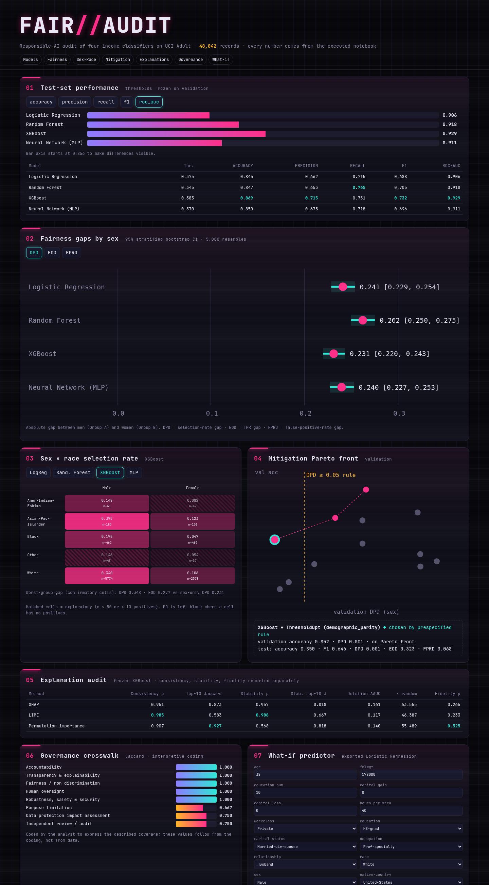</p>

A static dashboard (no server) built from `docs/data/results.json`, which the notebook exports:
- model comparison (switch metric)
- fairness gaps with 95% confidence intervals (DPD / EOD / FPRD)
- sex × race heatmap with sparse cells hatched
- **clickable Pareto front** that shows each operating point's validation and test numbers
- explanation-audit table and governance Jaccard bars
- an **in-browser what-if predictor** running the exported Logistic Regression, with a toggle for **group-specific thresholds**

Works on phones too ([mobile screenshot](docs/screenshot_mobile.png)).

## 🧭 Pipeline

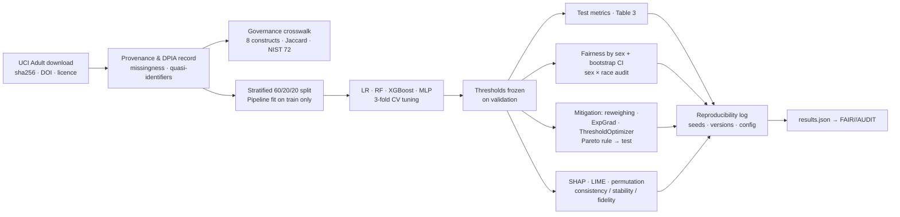

## 📚 Notebook and script

| # | File | What it does |
|---|---|---|
| 1 | [notebooks/Responsible_AI_UCI_Adult.ipynb](notebooks/Responsible_AI_UCI_Adult.ipynb) | Executed notebook with every section, table and figure |
| 2 | [scripts/responsible_ai_uci_adult.py](scripts/responsible_ai_uci_adult.py) | Plain-Python version, organised as one function per stage plus `main()`. Writes everything to `results/`. Verified to give **byte-identical** result CSVs to the notebook |
| 3 | [notebooks/Multi_Run_Seeds.ipynb](notebooks/Multi_Run_Seeds.ipynb) · [scripts/multi_run.py](scripts/multi_run.py) | Repeated runs over 10 seeds: per-run and summary CSVs, boxplots |
| 4 | [scripts/build_notebook.py](scripts/build_notebook.py) | Generates the notebook from source |

## 📈 Results (from the executed notebook, seed 42)

48,842 records (train + test files combined) · split 29,305 / 9,768 / 9,769 · 5,000 bootstrap resamples · runtime about 4 minutes on 8 CPU cores.

### Table 3 — test-set performance (threshold = max F1 on validation, then frozen)
| Model | Thr. | Accuracy | Precision | Recall | F1 | ROC-AUC |
|---|---|---|---|---|---|---|
| Logistic Regression | 0.375 | 0.845 | 0.662 | 0.715 | 0.688 | 0.906 |
| Random Forest | 0.345 | 0.847 | 0.653 | **0.765** | 0.705 | 0.918 |
| **XGBoost** | 0.385 | **0.869** | **0.715** | 0.751 | **0.732** | **0.929** |
| Neural Network (MLP) | 0.370 | 0.850 | 0.675 | 0.718 | 0.696 | 0.911 |

### Table 4 — frozen XGBoost by sex (test)
| Group | n | Positive prediction rate | TPR | FPR |
|---|---|---|---|---|
| A (Male) | 6,530 | 0.328 | 0.765 | 0.137 |
| B (Female) | 3,239 | 0.097 | 0.669 | 0.026 |
| \|A − B\| | | **0.231** | **0.096** | **0.111** |

### Table 5 — absolute gaps by sex, 95% stratified bootstrap CI (5,000 resamples)
| Model | Demographic parity | Equal opportunity | FPR difference |
|---|---|---|---|
| Logistic Regression | 0.241 [0.229, 0.254] | 0.137 [0.085, 0.192] | 0.129 [0.116, 0.142] |
| Random Forest | 0.262 [0.250, 0.275] | 0.116 [0.064, 0.169] | 0.150 [0.137, 0.163] |
| XGBoost | 0.231 [0.220, 0.243] | 0.096 [0.044, 0.149] | 0.111 [0.099, 0.123] |
| Neural Network (MLP) | 0.240 [0.227, 0.253] | 0.148 [0.094, 0.204] | 0.124 [0.111, 0.136] |

**Sex × race** (cells with n ≥ 50 and at least 10 positives count as confirmatory; the rest are flagged exploratory, and EO is blank when a cell has no positives): the worst-group selection-rate gap is 0.347 for LR, 0.389 for RF, 0.348 for XGBoost and 0.372 for MLP. In every model this is larger than the sex-only gap.

### Mitigation (prespecified rule: best validation accuracy with validation DPD ≤ 0.05)
Candidates scored on validation:
- the four baselines
- XGBoost + reweighing (DPD 0.146)
- ExponentiatedGradient-LR at ε ∈ {0.01, 0.02, 0.05, 0.1}
- XGBoost + ThresholdOptimizer (DP, equalized odds, TPR parity)

The Pareto front consists of the three ThresholdOptimizer points. The rule chose **XGBoost + ThresholdOptimizer (demographic parity)**, with these test results:

| | Accuracy | F1 | DPD | EOD | FPRD |
|---|---|---|---|---|---|
| XGBoost baseline | 0.869 | 0.732 | 0.231 | 0.096 | 0.111 |
| Chosen point | 0.850 | 0.646 | **0.001** | 0.323 | 0.068 |

The demographic parity gap almost disappears, but at the cost of accuracy, F1 and a much larger equal-opportunity gap.

### Table 6 — explanation audit on frozen XGBoost
| Method | Consistency ρ | Consistency top-10 Jaccard | Stability ρ | Stability top-10 J | Deletion ΔAUC | × random | Fidelity ρ |
|---|---|---|---|---|---|---|---|
| SHAP | 0.951 | 0.873 | 0.957 | 0.818 | 0.161 | 63.6 | 0.265 |
| LIME | 0.985 | 0.583 | 0.988 | 0.667 | 0.117 | 46.4 | 0.233 |
| Permutation importance | 0.907 | 0.927 | 0.568 | 0.818 | 0.140 | 55.5 | 0.525 |

No method is best on all three dimensions. SHAP gives the largest deletion drop, permutation importance has the most stable top-10 set and the highest fidelity ρ, and LIME's full ranking is the most repeatable while its top-10 set is the least.

### Governance crosswalk (interpretive coding)
Accountability, Transparency, Fairness, Human oversight and Robustness all score **1.000**. Purpose limitation scores **0.667**, DPIA **0.750** and Independent review **0.750**.
⚠️ The construct-to-framework sets were coded by the analyst to express the coverage described in the source study, so these values follow from the coding. They are **not** independent evidence. The NIST AI RMF 1.0 Core encoded here has GOVERN 19 / MAP 18 / MEASURE 22 / MANAGE 13 (72 in total). The reference study lists 21 / 14 for the last two.

## 🔁 Repeated runs (10 seeds)

The pipeline was rerun for **seeds 0–9**. Each seed changes the stratified split and every model's random state, and each run repeats training, validation thresholds, test metrics, fairness gaps by sex and the mitigation choice.
- Code: [scripts/multi_run.py](scripts/multi_run.py), executed notebook: [notebooks/Multi_Run_Seeds.ipynb](notebooks/Multi_Run_Seeds.ipynb), outputs: [results/multi_run/](results/multi_run/) (`per_run.csv`, `summary.csv`, `rank_stability.csv`, `mitigation_per_run.csv`, `mitigation_summary.csv`, `config.json`).
- **Simplifications (documented):**
  - Hyperparameters are fixed to the seed-42 CV choice, not re-tuned per seed.
  - Each run uses **500** bootstrap resamples instead of 5,000.
  - The **explanation audit is not repeated**, because it is the slowest stage, so Table 6 stays single-run.
- Total runtime was 22.6 minutes on 8 CPU cores. The single-run results above are unchanged.

**Mean ± std over 10 seeds (test set)**

| Model | Accuracy | F1 | ROC-AUC | DPD | EOD | FPRD |
|---|---|---|---|---|---|---|
| Logistic Regression | 0.839 ± 0.007 | 0.688 ± 0.005 | 0.905 ± 0.002 | 0.255 ± 0.018 | 0.142 ± 0.024 | 0.143 ± 0.020 |
| Random Forest | 0.854 ± 0.005 | 0.706 ± 0.007 | 0.916 ± 0.003 | 0.235 ± 0.013 | 0.109 ± 0.028 | 0.121 ± 0.014 |
| XGBoost | 0.867 ± 0.004 | 0.728 ± 0.005 | 0.928 ± 0.002 | 0.228 ± 0.019 | 0.107 ± 0.026 | 0.106 ± 0.018 |
| Neural Network (MLP) | 0.843 ± 0.006 | 0.699 ± 0.005 | 0.911 ± 0.003 | 0.259 ± 0.018 | 0.133 ± 0.034 | 0.145 ± 0.019 |

**Min–max over 10 seeds**

| Model | Accuracy | ROC-AUC | DPD | EOD |
|---|---|---|---|---|
| Logistic Regression | 0.825–0.848 | 0.900–0.908 | 0.233–0.285 | 0.108–0.176 |
| Random Forest | 0.846–0.861 | 0.910–0.920 | 0.220–0.265 | 0.071–0.154 |
| XGBoost | 0.861–0.873 | 0.925–0.932 | 0.198–0.260 | 0.076–0.151 |
| Neural Network (MLP) | 0.833–0.853 | 0.907–0.915 | 0.230–0.283 | 0.078–0.206 |

**How often each model is best (out of 10 seeds)**

| Metric | LR | RF | XGBoost | MLP |
|---|---|---|---|---|
| accuracy (highest) | 0 | 0 | 10 | 0 |
| f1 (highest) | 0 | 0 | 10 | 0 |
| roc_auc (highest) | 0 | 0 | 10 | 0 |
| DPD (lowest) | 1 | 3 | 6 | 0 |
| EOD (lowest) | 0 | 4 | 5 | 1 |
| FPRD (lowest) | 0 | 2 | 8 | 0 |

<table>
<tr><td width="50%">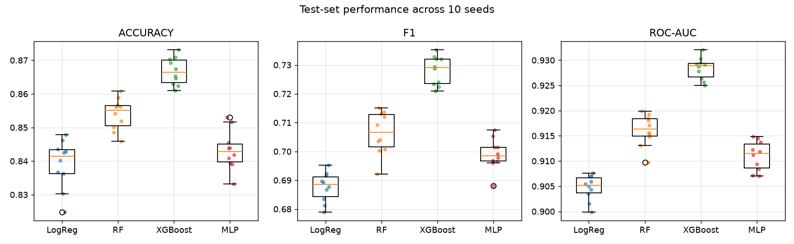<br><sub>Accuracy, F1, ROC-AUC across 10 seeds</sub></td>
<td width="50%">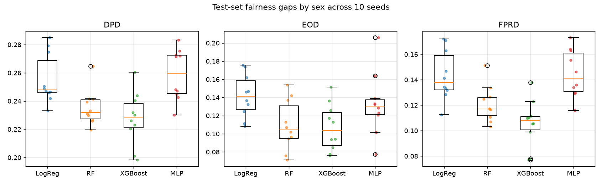<br><sub>DPD, EOD, FPRD by sex across 10 seeds</sub></td></tr>
</table>

What the repeated runs show:
- **Performance is stable.** The standard deviation across seeds is at most 0.007 for accuracy and 0.003 for ROC-AUC.
  - XGBoost has the highest accuracy, F1 and AUC in **10/10** seeds.
  - The full AUC order (XGBoost > RF > MLP > LR) is identical in 10/10 seeds.
  - The accuracy order of the weaker models is less stable: the full order held in 6/10 seeds, and LR and MLP swap places in 3.
  - In the single seed-42 run, MLP edged out RF on accuracy. Over 10 seeds RF is ahead on average (0.854 vs 0.843), so that single-run gap was within seed noise.
- **Fairness gaps vary more than accuracy.** The DPD std is 0.013–0.019, and the EOD std is 0.024–0.034, wide enough to change the ranking between seeds.
  - XGBoost has the lowest DPD in 6/10 seeds, the lowest EOD in 5/10 and the lowest FPRD in 8/10, so "which model is fairest" is **not** stable across seeds.
  - Every model has a DPD gap of at least 0.198 in every seed.
- **The mitigation choice is fully stable.** The prespecified rule picked **XGBoost + ThresholdOptimizer (demographic parity)** in 10/10 seeds.
  - Test DPD: 0.007 ± 0.005
  - Accuracy: 0.852 ± 0.002
  - F1: 0.636 ± 0.014
  - EOD: 0.323 ± 0.027, consistently far above the baseline. The same trade-off appears in every seed.

## 🖼️ Output gallery

<table>
<tr><td width="50%">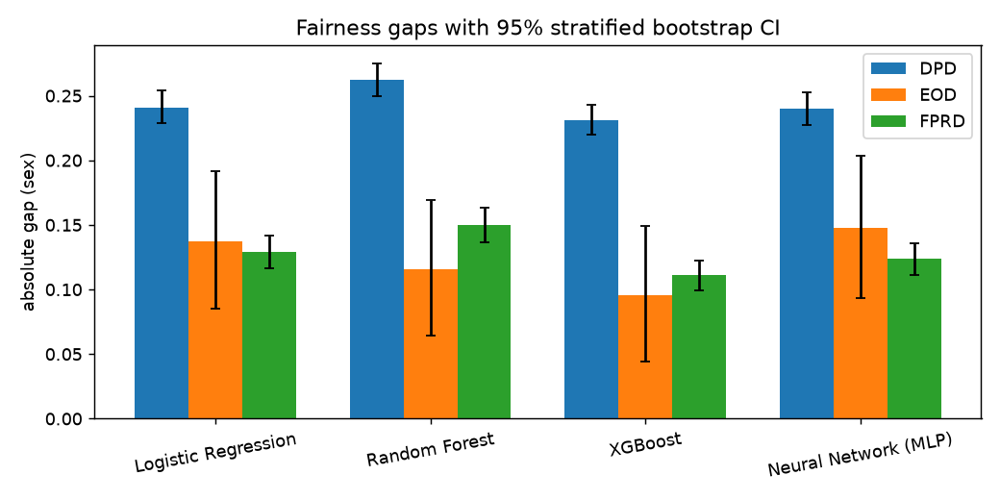<br><sub>Fairness gaps with 95% bootstrap CI</sub></td>
<td width="50%">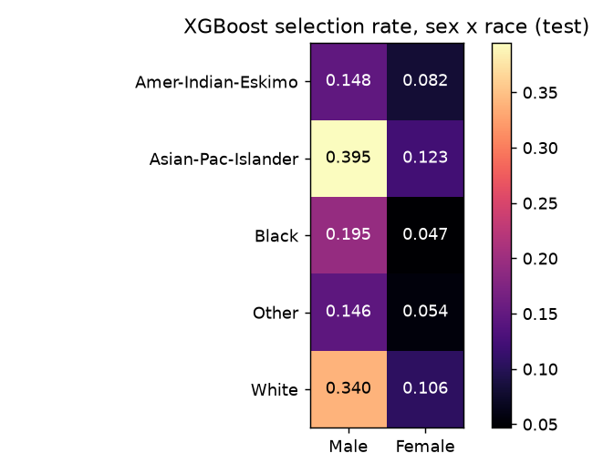<br><sub>XGBoost selection rate, sex × race</sub></td></tr>
<tr><td>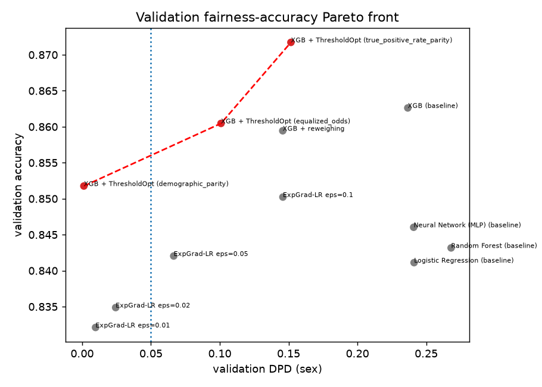<br><sub>Validation fairness–accuracy Pareto front</sub></td>
<td>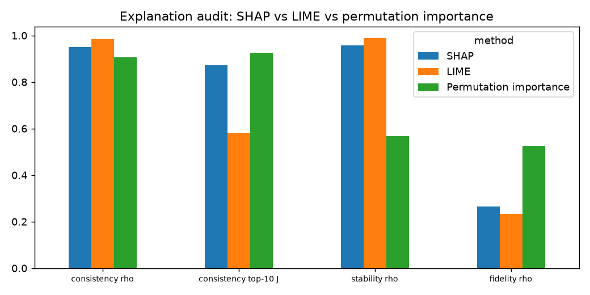<br><sub>SHAP vs LIME vs permutation importance</sub></td></tr>
<tr><td>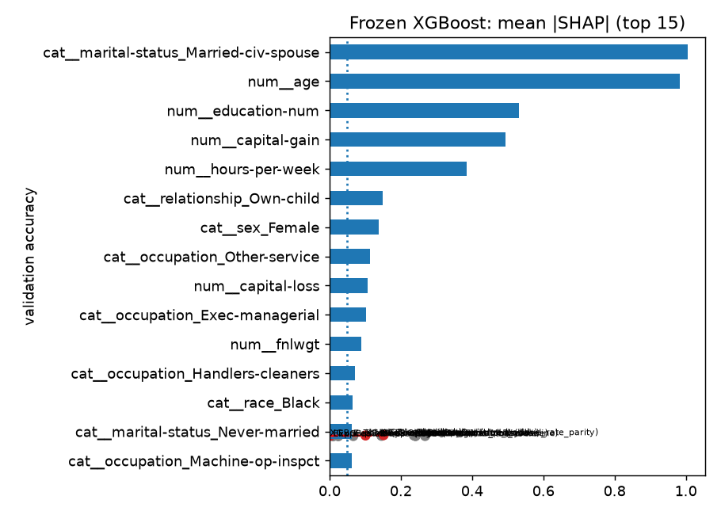<br><sub>Mean |SHAP|, top 15 features</sub></td>
<td>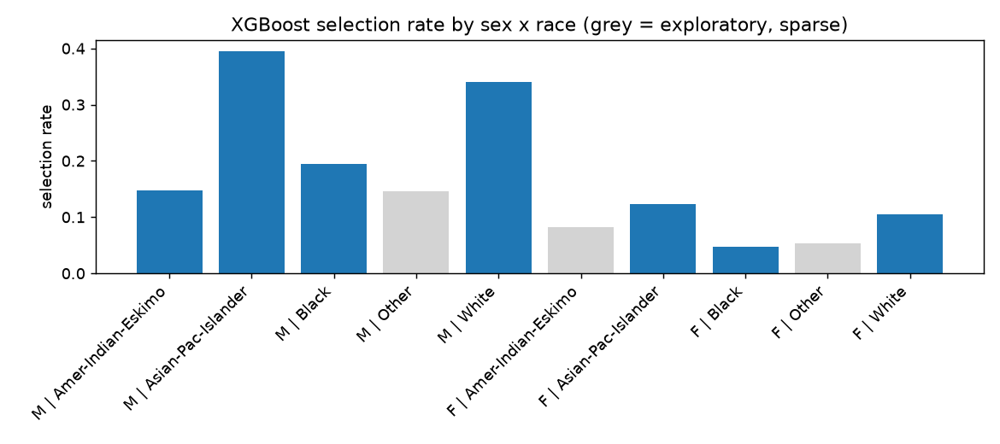<br><sub>Sex × race selection rate (grey = exploratory)</sub></td></tr>
<tr><td>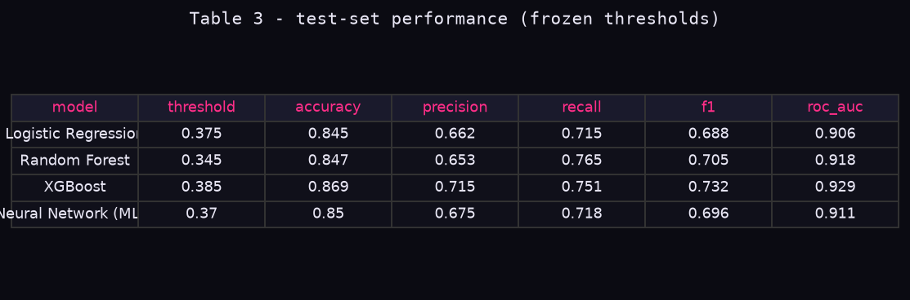<br><sub>Table 3 output</sub></td>
<td>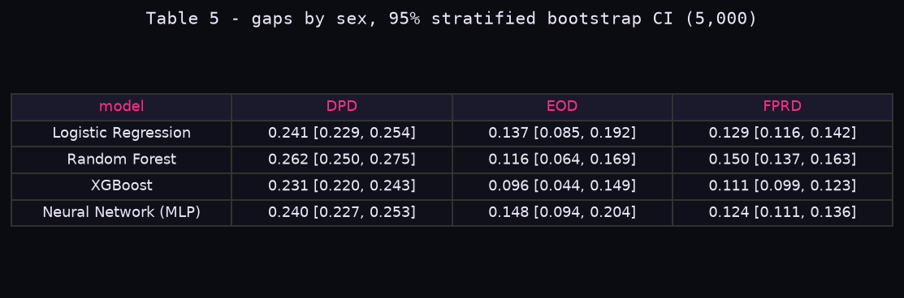<br><sub>Table 5 output</sub></td></tr>
<tr><td>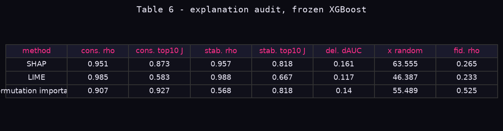<br><sub>Table 6 output</sub></td>
<td>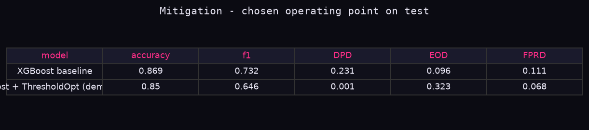<br><sub>Mitigation on test</sub></td></tr>
<tr><td>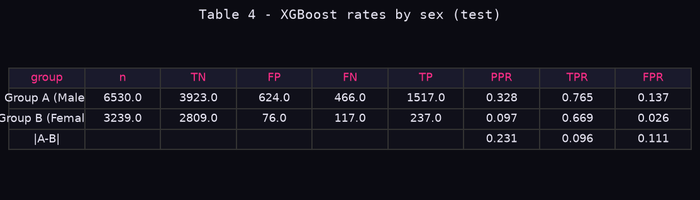<br><sub>Table 4 output</sub></td>
<td>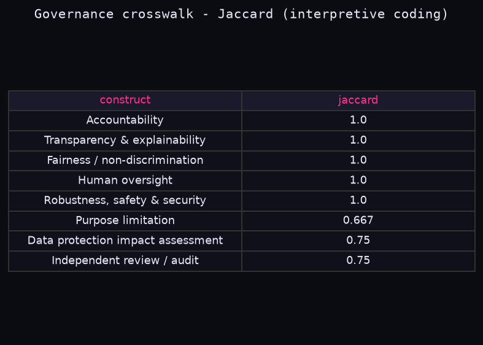<br><sub>Governance Jaccard</sub></td></tr>
<tr><td><br><sub>Dashboard (desktop)</sub></td>
<td>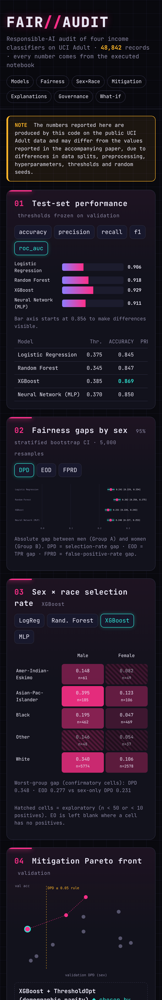<br><sub>Dashboard (mobile)</sub></td></tr>
</table>

## 🔍 Reference values vs reproduced
Neutral comparison with the values reported in the study this project implements (full table: [results/paper_vs_reproduced.csv](results/paper_vs_reproduced.csv), image: [figure](results/figures/paper_vs_reproduced.png)).

| Metric | Reported | Reproduced | Δ |
|---|---|---|---|
| XGBoost accuracy / F1 / AUC | 0.901 / 0.862 / 0.951 | 0.869 / 0.732 / 0.929 | −0.032 / −0.130 / −0.022 |
| MLP accuracy / F1 | 0.893 / 0.851 | 0.850 / 0.696 | −0.043 / −0.155 |
| RF accuracy / F1 | 0.879 / 0.833 | 0.847 / 0.705 | −0.032 / −0.128 |
| LR accuracy / AUC | 0.842 / 0.891 | 0.845 / 0.906 | +0.003 / +0.015 |
| XGBoost DPD / EOD / FPRD | 0.162 / 0.128 / 0.104 | 0.231 / 0.096 / 0.111 | +0.069 / −0.032 / +0.007 |
| LR DPD / EOD / FPRD | 0.102 / 0.081 / 0.063 | 0.241 / 0.137 / 0.129 | +0.139 / +0.056 / +0.066 |
| XGBoost worst-group DPD (sex × race) | 0.214 | 0.348 | +0.134 |
| SHAP / PI / LIME consistency ρ | 0.91 / 0.87 / 0.82 | 0.951 / 0.907 / 0.985 | |
| SHAP / PI / LIME top-10 Jaccard | 0.88 / 0.83 / 0.74 | 0.873 / 0.927 / 0.583 | |
| SHAP / LIME / PI stability | 0.86 / 0.71 / 0.80 | 0.957 / 0.988 / 0.568 | |
| PI / SHAP / LIME fidelity | 0.88 / 0.84 / 0.79 | 0.525 / 0.265 / 0.233 | defined differently |

Main differences:
- **Performance:** accuracy, F1 and AUC came out lower than reported, F1 especially. Here recall is higher than precision.
- **Fairness:** the gaps by sex are larger than reported, and similar across all four models. XGBoost has the smallest DPD and EOD gaps here, and the confidence intervals overlap.
- **Fidelity:** the reference study doesn't specify its fidelity metric, so those rows can only be compared loosely.

## 🗂️ Data
**Adult (Census Income)**, UCI Machine Learning Repository, DOI [10.24432/C5XW20](https://doi.org/10.24432/C5XW20), licensed CC BY 4.0
(Becker & Kohavi, 1996). The data is **not committed**. It is downloaded at run time from the UCI archive and sha256-hashed into [results/provenance.json](results/provenance.json):
```python
import urllib.request
BASE = "https://archive.ics.uci.edu/ml/machine-learning-databases/adult/"
for f in ["adult.data", "adult.test", "adult.names"]:
    urllib.request.urlretrieve(BASE + f, f"data/{f}")
```
Missing values appear only in workclass, occupation and native-country. Quasi-identifiers are recorded, and mitigations apply: no re-identification, no linkage, aggregate-only reporting.

## 🚀 How to run
```bash
git clone https://github.com/Rishabh-bgp/responsible-ai-uci-adult.git
cd responsible-ai-uci-adult
python -m venv .venv && source .venv/bin/activate
pip install -r requirements.txt
python scripts/responsible_ai_uci_adult.py        # writes results/ (about 4 min on 8 cores)
python scripts/multi_run.py --seeds 10 --boot 500  # repeated runs → results/multi_run/ (about 23 min)
# or run the notebook (writes outputs next to the notebook):
cd notebooks && jupyter nbconvert --to notebook --execute --inplace Responsible_AI_UCI_Adult.ipynb
```
Run the dashboard locally: `cd docs && python -m http.server 8000`, then open http://localhost:8000.

## 📁 Repository layout
```
notebooks/   executed Jupyter notebook
scripts/     responsible_ai_uci_adult.py (full pipeline), build_notebook.py
results/     table CSVs, provenance.json, reproducibility_log.json, web_results.json, figures/, multi_run/ (10-seed experiment)
docs/        FAIR//AUDIT dashboard on GitHub Pages (index.html, style.css, app.js, data/results.json, screenshots)
requirements.txt  LICENSE  README.md
```

## ⚠️ Limitations
- One benchmark from the 1994 U.S. Census. Labels reflect historical labour-market inequality, so the disparities found here should not be applied to other populations.
- The governance crosswalk is an interpretive coding, not an official mapping.
- Hyperparameter grids are kept small so the pipeline runs on a CPU, so better-tuned models could score higher.
- Explanation scores depend on the perturbation regimes chosen, and fidelity is measured by feature deletion.
- There is no deployment context, so harms are inferred from error rates. The what-if predictor is an illustration and must not be used for decisions about individuals.

## 👥 Contributors

| Name | Affiliation | Contribution |
|---|---|---|
| **Rishabh Aryan** (lead) | M.Tech (Artificial Intelligence and Data Science), Department of Computer Science and Engineering, Indian Institute of Information Technology, Bhagalpur (Bihar) · rishabh.250201011@iiitbh.ac.in | Conceptualization, modelling pipeline, fairness evaluation and mitigation, live dashboard |
| Nikshep Paliwal | PhD (Visvesvaraya Fellowship), NIELIT Deemed to be University, Ropar, Punjab, India · ndu202501348@nielit.ac.in | Governance framework crosswalk (NIST/OECD/EU AI Act/IEEE), data provenance and DPIA, explainability audit (SHAP/LIME/permutation) |
| Nishtha Kalia | BCA, Department of Computer Science and Applications, Mehr Chand Mahajan DAV College for Women, Panjab University, Chandigarh, India · nishtha.kalia.2411@gmail.com | Literature review, documentation and writing, results validation |

## 🔗 Related repositories
- [Machine Learning Part 1](https://github.com/Rishabh-bgp/machine-learning-part-1) — heart-disease classification & insurance-cost regression
- [Machine Learning Part 2](https://github.com/Rishabh-bgp/machine-learning-part-2) — YOLO11 task tour & potato leaf disease classification
- [Machine Learning Part 3](https://github.com/Rishabh-bgp/machine-learning-part-3) — road damage detection · [live demo](https://rishabh-bgp.github.io/machine-learning-part-3/)
- **Responsible AI on UCI Adult** — fairness, explainability & governance audit (this repository)
- [NIELIT Machine Learning Projects](https://github.com/Rishabh-bgp/NIELIT-MACHINE-LEARNING-PROJECTS)
- [All repositories](https://github.com/Rishabh-bgp?tab=repositories)

## 📄 License
[MIT](LICENSE) © 2026 Rishabh Aryan. The UCI Adult dataset is by Becker & Kohavi (CC BY 4.0). It is not redistributed here.
